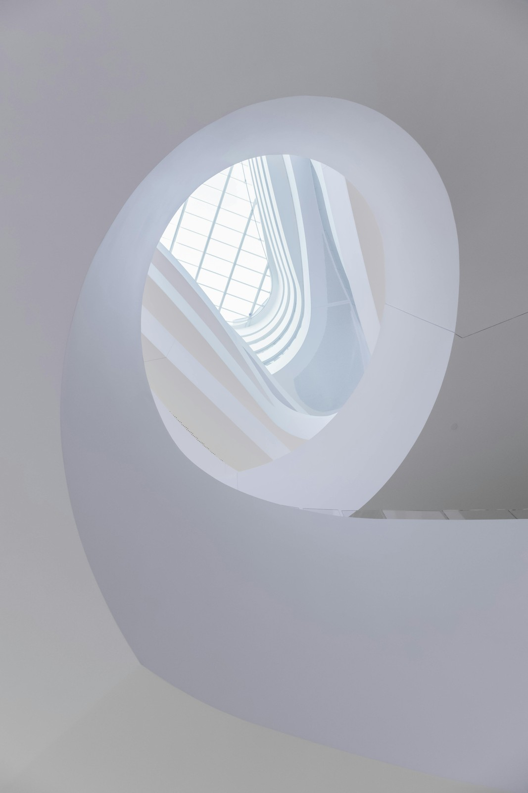

## Project Overviews

This project involved designing a visually immersive website for outdoor enthusiasts, showcasing camping destinations, gear reviews, and adventure guides. Emphasis was placed on clean layouts, engaging imagery, and intuitive navigation, allowing users to easily explore options, plan trips, and access information without distraction, creating an experience that feels both practical and inspiring.

## Work process

This camping website aimed to create an immersive and engaging experience for outdoor enthusiasts, combining visual storytelling with easy navigation and practical information. The design process emphasized accessibility, usability, and engagement.

- Understanding user needs and camping trends
- Planning content structure and navigation
- Wireframing layouts for desktop and mobile
- Designing visuals with engaging imagery and interactive elements
- Development ensuring responsiveness and fast load times
- User testing and iteration based on feedback

 

## Approach

The approach for the camping website focused on creating an engaging, accessible, and immersive digital experience for outdoor enthusiasts. Every design choice, from layout to interactive features, was made to enhance usability while conveying a sense of adventure. While clarity and navigation are essential, overlooking visual hierarchy or accessibility can result in a disjointed user experience. Likewise, decorative elements are applied thoughtfully rather than excessively, ensuring that inspiration and function coexist. For instance, combining interactive maps with gear guides allows users to plan trips efficiently while feeling fully engaged with the content.

> "A website should not only provide information but also invite exploration, capturing the spirit of adventure through design and interaction. Navigation, visuals, and content must work together seamlessly to inspire users while keeping them oriented. The balance between engagement and clarity ensures that every visit becomes an enjoyable experience."

## Solution

The solution involved combining a visually engaging and dynamic layout with practical tools and interactive elements, allowing users to explore destinations, gear, and guides seamlessly. By carefully balancing immersive imagery with intuitive navigation and subtle animations, the website creates a cohesive and memorable experience that communicates both inspiration and utility, capturing the adventurous spirit of the brand while ensuring accessibility and ease of use.
