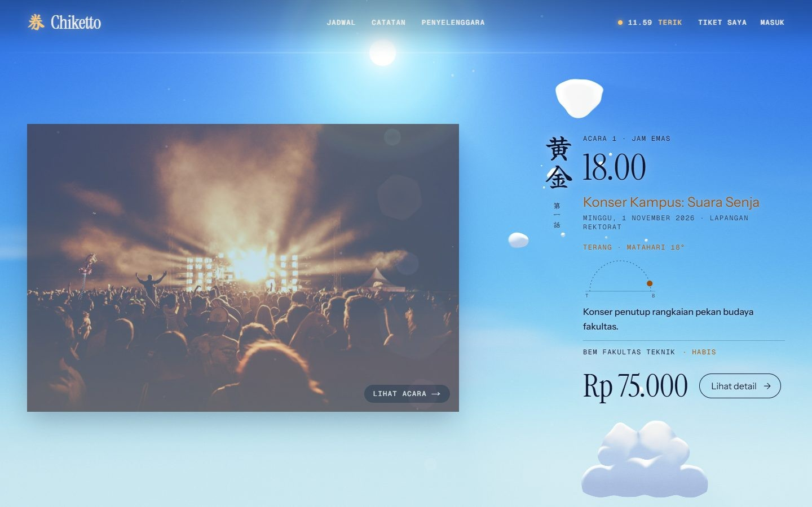
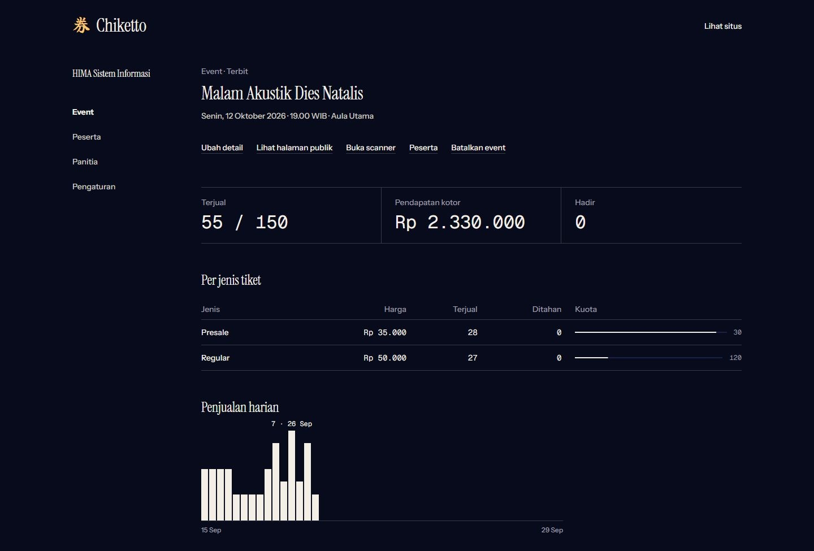

## Project Overview

Campus events are usually sold through a Google Form, a manual bank transfer, and a committee member checking every proof of payment by hand. Chiketto automates that whole flow. Payments are confirmed automatically through a Midtrans webhook, e-tickets are issued on their own and sent by email, and check-in at the venue takes a single scan of a QR code.

The platform serves four roles:

- **Buyers** browse the schedule, filter and search events, buy tickets through Midtrans Snap (or instantly for free events), open their tickets even when offline, download PDF e-tickets, and verify their campus email to unlock student-only prices.
- **Organizers** create events from draft to published with posters and ticket types (price, quota, sales period, student-only), follow sales statistics and daily charts, export attendee lists to Excel or CSV, and invite committee members.
- **Committee members** use a mobile QR scanner with four outcomes (valid, already checked in, different event, unknown) and distinct vibration patterns, with a manual code input as a fallback.
- **Platform admins** verify organizations and deactivate problematic events.

## Design

The interface follows a Hikari-inspired theme: a sky that changes with the hour, cream ink, and amber light accents. Behind the home page runs a single WebGL2 canvas with a three-pass shader pipeline (occlusion, volumetric sun rays, composite) that renders procedural clouds, stars, the moon, and a silhouette of a city, power lines, mountains, and a giant 券 kanji. The sun follows the cursor in the hero, and scrolling moves the sky clock from early morning to past midnight while text colors switch between navy and cream to stay readable. The engine respects `prefers-reduced-motion` and lowers its render quality automatically when frames start dropping.

## Organizer Dashboard

Each event has its own dashboard showing tickets sold against capacity, gross revenue, attendance, a breakdown per ticket type with quota bars, and a daily sales chart. Organizers can manage ticket types, open the public page, launch the scanner, view attendees, or cancel the event from the same screen.

## Payments, Quotas & Secure QR

An order is marked paid **only** from a verified webhook, never from a browser redirect: the SHA-512 signature is checked, the status is confirmed again with the Midtrans API, and the ticket is issued in the same database transaction. To prevent overselling, quota is reserved with a single conditional `UPDATE` in PostgreSQL, so 50 simultaneous checkouts for 10 remaining seats produce exactly 10 orders. Row locks and conditional state transitions also handle double clicks, duplicate webhooks, orders expiring at the same moment they are paid, and two committee members scanning the same ticket.

QR codes do not contain a plain ticket ID but a token signed with HMAC-SHA256, so forged codes are rejected before the database is touched, and a screenshot of a valid QR can only be used once. All of these edge cases are covered by integration tests against a real PostgreSQL database.

## Tech Stack

The app is built with Next.js 15 (App Router and Server Actions), React 19, and TypeScript, styled with Tailwind CSS v4. Data lives in PostgreSQL 16 through Prisma 6 with Zod validation, and authentication uses Auth.js with email magic links. A BullMQ worker on Redis sends e-ticket emails built with React Email and expires unpaid orders, while @react-pdf/renderer generates PDF tickets and ExcelJS exports attendee lists. The code is tested with Vitest for unit and integration tests and Playwright for end-to-end tests.
