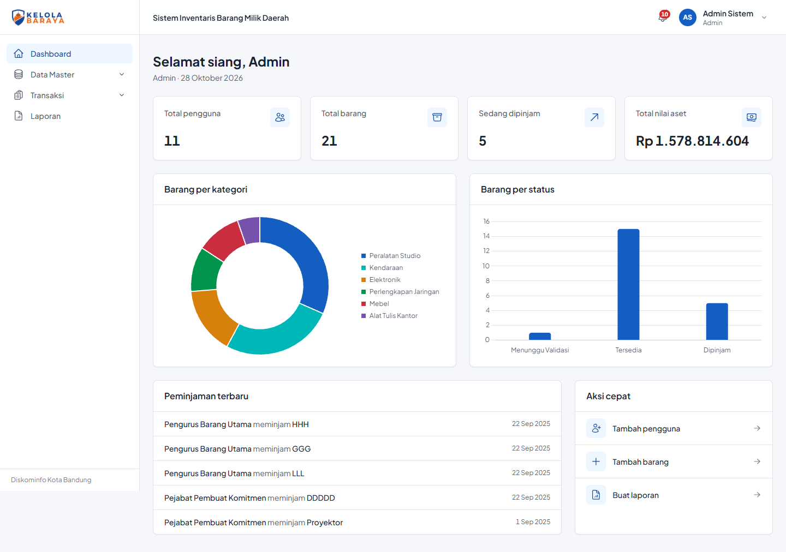
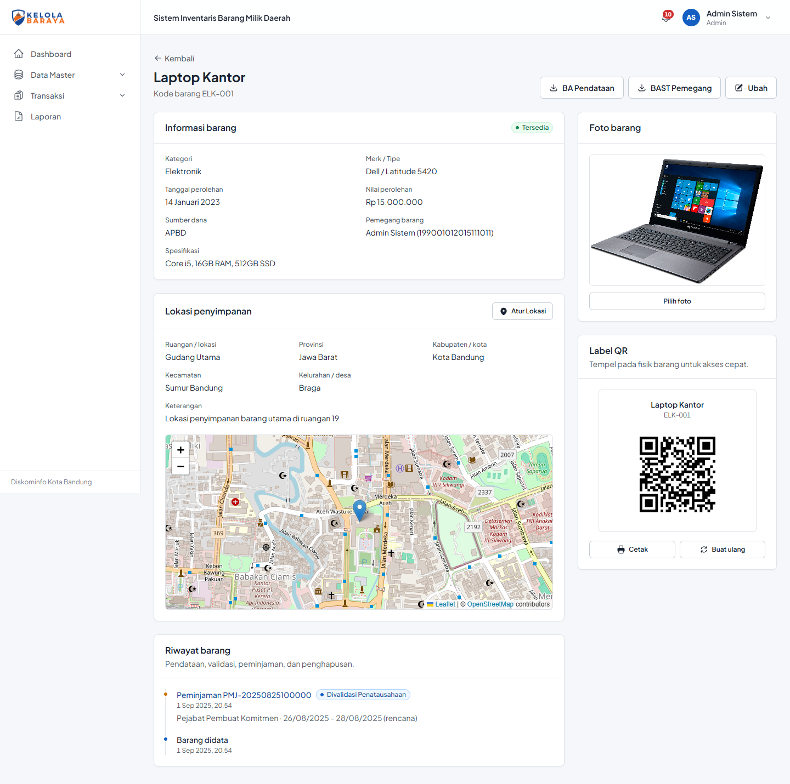

## Project Overview

Kelola Baraya is an inventory system for Barang Milik Daerah (regional government assets) that I built during my internship at Dinas Komunikasi dan Informatika (Diskominfo) Kota Bandung. Before this system, asset records, loan requests, and approval letters were handled manually and spread across documents. Kelola Baraya brings the whole asset lifecycle into one application: needs planning (RKBMD), procurement, registration, lending, and disposal, with every status change validated by the right person and recorded for auditing.

## Roles & Workflows

The system serves six roles, Admin, Pengurus Barang, Penata Usaha Barang, PPK, Kepala Bidang, and Kepala Dinas, each with its own dashboard, menu, and access rights enforced on both the frontend and the API. Every transaction follows a tiered approval flow that mirrors the real bureaucratic process:

- **Needs planning (RKBMD)**: submitted, validated per item, approved by the Head of Agency, then completed by the Admin
- **Procurement (SPK/BAST)**: checked and approved, after which every item automatically enters the inventory with its own QR code
- **Lending**: internal and external loans with separate validation paths, and overdue loans are flagged automatically
- **Disposal**: approved by the Head of Agency and closed with an uploaded, signed official report
- Sequential proposal numbers per year (e.g. `PMJ/2026/0001`) and a validation log for every status change, shown as a timeline

## Asset Management

Each asset has complete details, including category, brand, specifications, acquisition date and value, funding source, photo, and the person responsible for it. Storage locations are geotagged on an interactive Leaflet and OpenStreetMap map with address search. Every item gets a printable QR label; scanning it opens a public page with the item's information without logging in. The asset history shows the full trail of registration, validation, lending, and disposal, and asset data can be imported in bulk from Excel.

## Documents & Reports

Official documents such as registration reports, handover reports (BAST), disposal reports, and proposal letters are generated automatically as PDFs with Puppeteer. Inventory and transaction reports can be exported to PDF, Word, and Excel, removing hours of manual paperwork for the asset management team.

## Architecture & Quality

The frontend is a React single-page application built with Vite and Tailwind CSS, using a token-based design system and Chart.js for dashboard charts. The backend is a REST API on Express with PostgreSQL, organized into routes, controllers, and services, with multi-query operations wrapped in database transactions to keep data consistent. Security includes JWT authentication with role-based authorization, bcrypt password hashing, login rate limiting, helmet security headers, restricted CORS, and Zod validation for every request. Code quality is maintained with ESLint, Prettier, unit and integration tests using Jest and Supertest, and a GitHub Actions CI pipeline that lints, tests, and builds the project on every push.
