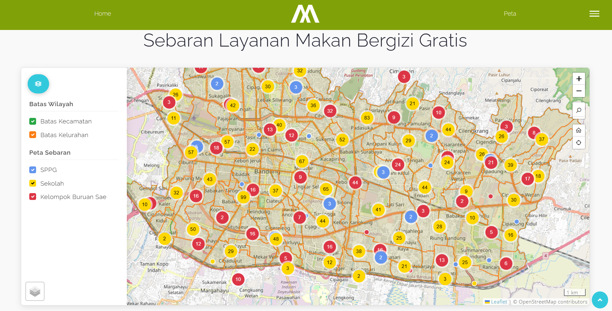

## Project Overview

Makan Bergizi Gratis (MBG) is a national program that provides free nutritious meals to students, prepared by service units called SPPG. To help the city government see how well the program reaches its schools, I built an interactive web map for Diskominfo Kota Bandung. The map puts SPPG locations, schools, and Kelompok Buruan Sae (the city's urban farming groups that can supply local produce) side by side with administrative boundaries, so decision makers can quickly spot which areas are well served and which still have gaps.

## Data

All data is stored as static GeoJSON files, so the map needs no backend and can be hosted anywhere:

- **SPPG**: 41 points with the unit name, head of SPPG, address, schools served, and total number of students
- **Schools**: 1,798 records, 1,786 of them with coordinates, including name, NPSN, education level, status, and address
- **Kelompok Buruan Sae**: 472 points with the extension officer, sub-district, RW, and commodities
- **District boundaries**: 30 polygons
- **Sub-district boundaries**: 151 polygons

## Features

The map is built with Leaflet 1.9 on OpenStreetMap tiles. Because there are more than 2,000 points, nearby markers are grouped with Leaflet.markercluster and color-coded per layer (blue for SPPG, yellow for schools, red for Kelompok Buruan Sae), expanding into individual markers as users zoom in. A side panel lets users toggle the district and sub-district boundaries and each distribution layer independently, and clicking a marker opens a popup with its details. The map also includes zoom controls, location search, a home button to reset the view, a locate-me button, and a basemap switcher.

## Tech Stack

The project uses Vite 7 as the development server and build tool. The navbar, side menu, and modals come from a Bootstrap 4 and jQuery template, with icons from Line Awesome and Font Awesome. Keeping everything static made the map fast to load, simple to deploy, and easy to update by replacing the GeoJSON files.
