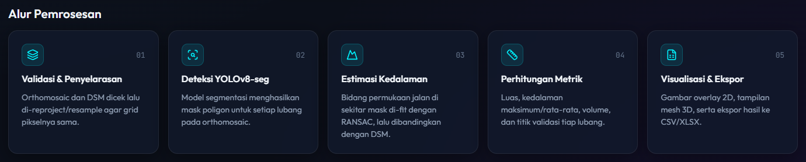
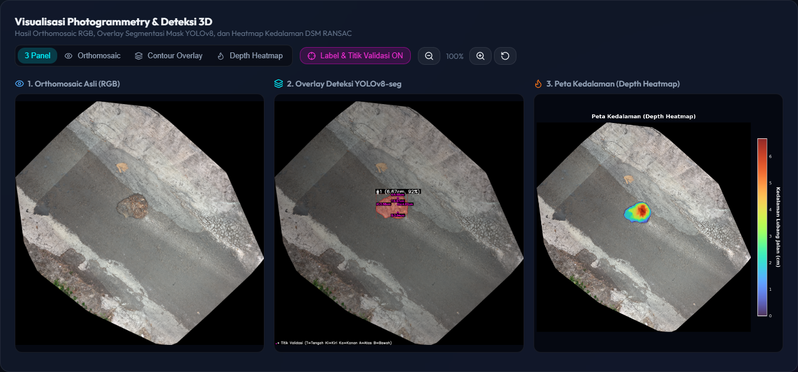
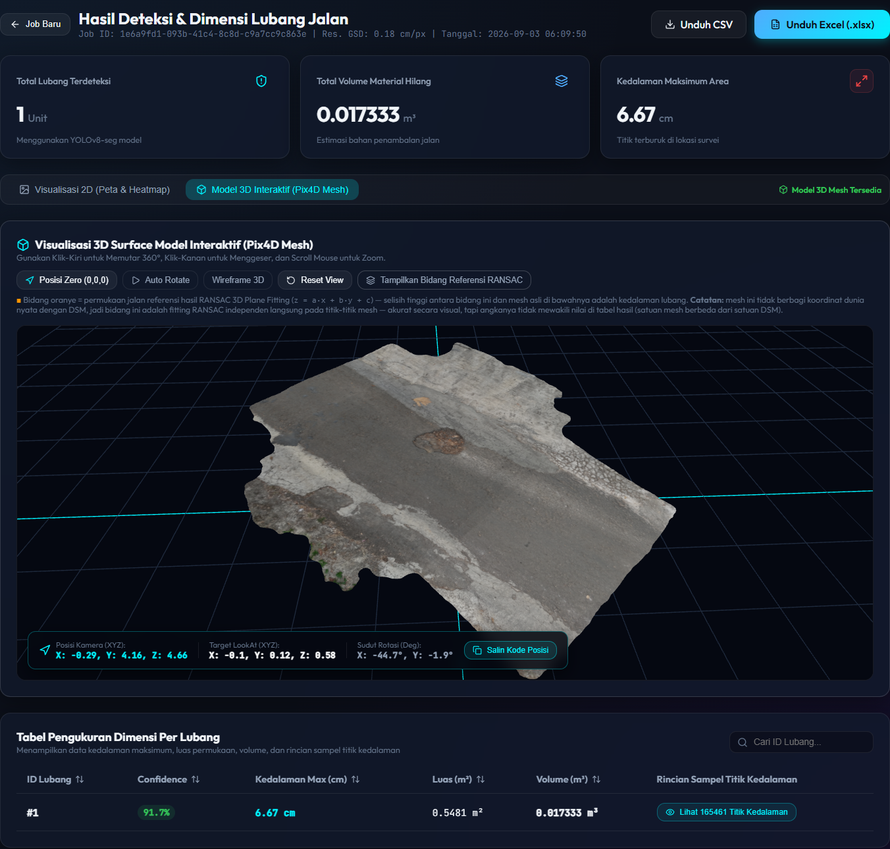

## Project Overview

Road repair planning usually depends on manual inspection, which is slow and makes it hard to estimate how much patching material is needed. Pothole3D Vision automates this from aerial survey data. Users upload an orthomosaic and a Digital Surface Model (DSM) produced by photogrammetry software such as Pix4Dmapper or WebODM, and the system detects every pothole, measures its depth relative to the surrounding road surface, and calculates its area and volume, giving an estimate of the material needed for repair.
## Processing Pipeline

1. **Validation & alignment**: the orthomosaic and DSM are checked, then reprojected and resampled with Rasterio so both share the same pixel grid.
2. **Detection**: a YOLOv8 segmentation model produces a polygon mask for each pothole on the orthomosaic.
3. **Depth estimation**: the road surface in a buffer around each mask is fitted as a 3D plane with RANSAC, and the difference between that plane and the DSM becomes the pothole's depth.
4. **Metrics**: area, maximum and average depth, volume, and validation points (the deepest point plus four edge points) are calculated for every pothole.
5. **Visualization & export**: results are rendered as 2D overlays and heatmaps, an optional 3D mesh view, and downloadable CSV and XLSX files.

## Results & Visualization

The results page summarizes the number of potholes, the total volume of missing material, and the maximum depth. A three-panel view compares the original orthomosaic, the YOLOv8 segmentation overlay with labels and validation points, and a depth heatmap, while a table lists each pothole's confidence, maximum depth, area, volume, and the full set of sampled depth points.

When a textured OBJ mesh from Pix4Dmapper is uploaded, the surface can also be explored as an interactive 3D model built with Three.js, with orbit controls, auto rotate, wireframe mode, and an optional display of the RANSAC reference plane.

## Tech Stack

The backend is a FastAPI service in Python that runs YOLOv8-seg inference with Ultralytics and PyTorch (with optional CUDA acceleration), processes GeoTIFF rasters with Rasterio and OpenCV, fits planes with scikit-learn's RANSAC, and generates reports with pandas. Processing runs as jobs that can be tracked, renamed, revisited from the job history, and exported. The frontend is a React and Vite single-page application with Three.js for the 3D viewer, supporting dark and light themes. Users can choose between several trained models and adjust the confidence threshold and RANSAC buffer for each job.
