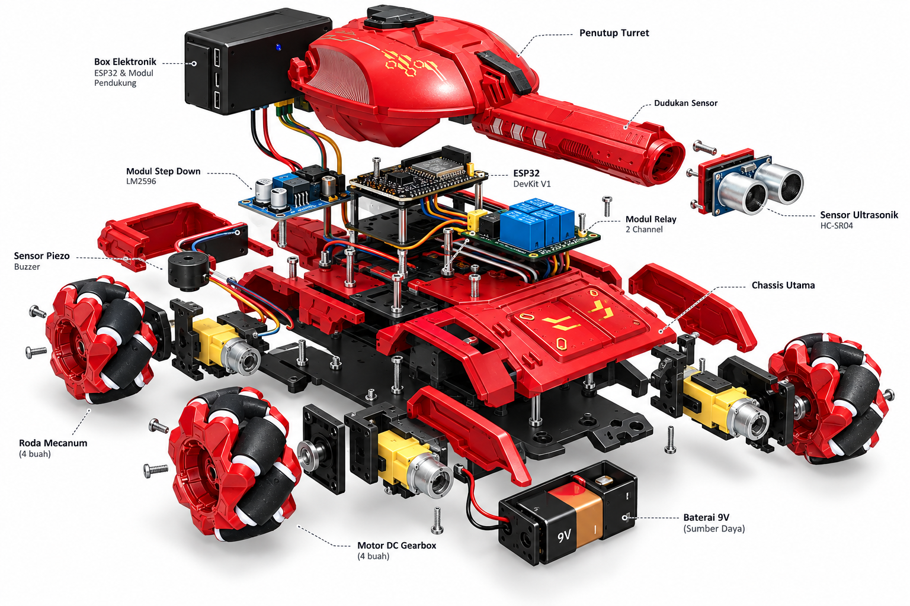
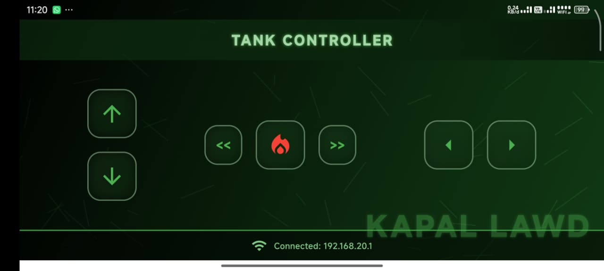
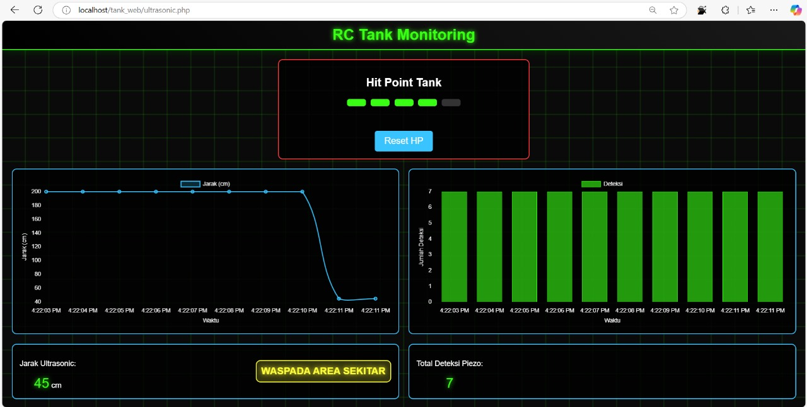
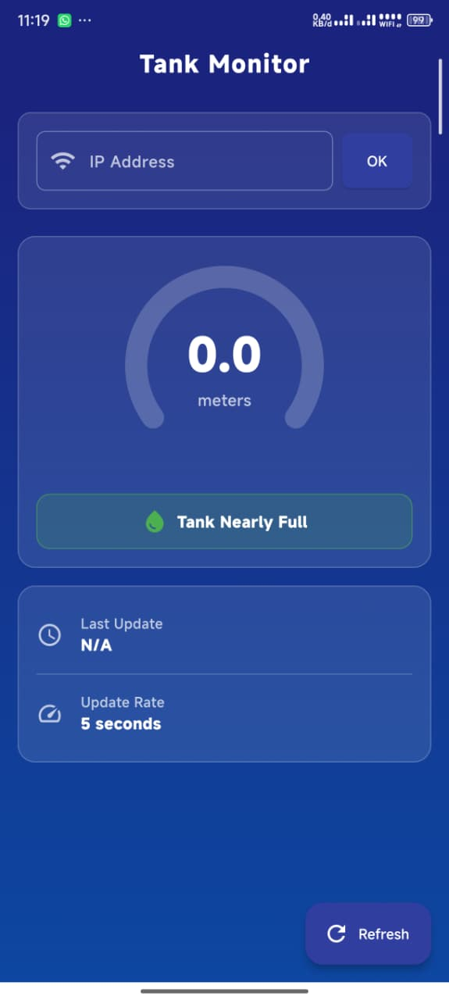

## Project Overview

RC Tank IoT is a remote-controlled tank that combines embedded hardware, mobile apps, and a web dashboard into one connected system. The tank runs on an ESP32 and moves on four mecanum wheels, so it can drive forward, backward, strafe sideways, and rotate in place. An HC-SR04 ultrasonic sensor watches for nearby obstacles, while a piezo sensor detects hits and reduces the tank's hit points, turning the project into a small battle game.

## Hardware

- **ESP32 DevKit V1** as the main controller, handling Wi-Fi, motor control, and sensor readings
- **4 DC gearbox motors** with **mecanum wheels** for omnidirectional movement
- **2-channel relay module** to switch the turret and other actuators
- **HC-SR04 ultrasonic sensor** mounted on the turret to measure distance
- **Piezo sensor** to detect hits on the tank body
- **LM2596 step-down module** powered by a **9V battery** to supply stable voltage

## Tank Controller App

The tank is driven from a Flutter app that connects directly to the ESP32 over Wi-Fi. The layout is made for landscape use: forward and backward on the left, strafe left/right and the fire button in the middle, and rotation on the right.

## Monitoring

Sensor readings from the ESP32 are published over MQTT and stored in MySQL, so they can be displayed live and kept as history.

The **web dashboard** (HTML, CSS, JavaScript) shows the tank's hit points with a reset button, a real-time distance chart, a piezo detection chart, and a warning when an object comes too close.

The **Tank Monitor** mobile app built with Flutter shows the current distance as a gauge, the tank status, and the last update time, refreshing every few seconds.

## Result

The project brings together hardware, networking, mobile, and web development in one system. It covers real-time control with low latency over Wi-Fi, reliable sensor data delivery through MQTT, and clear visualization for both desktop and mobile users.
