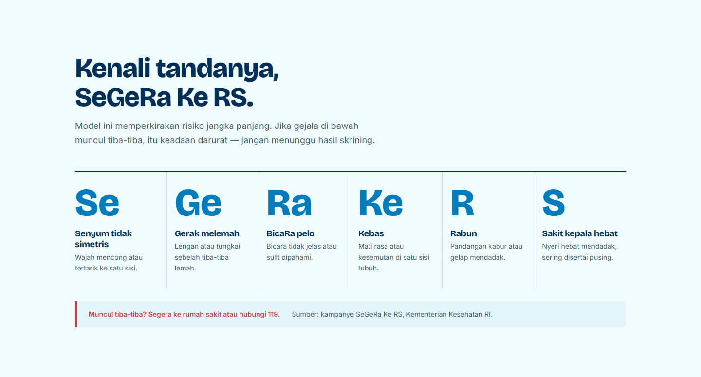
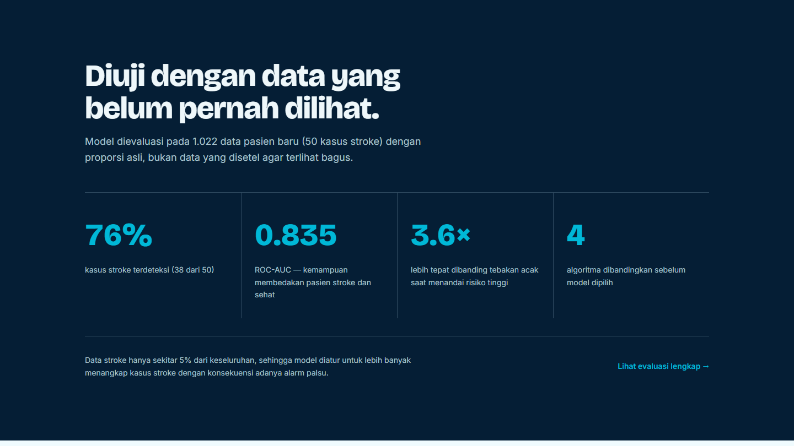
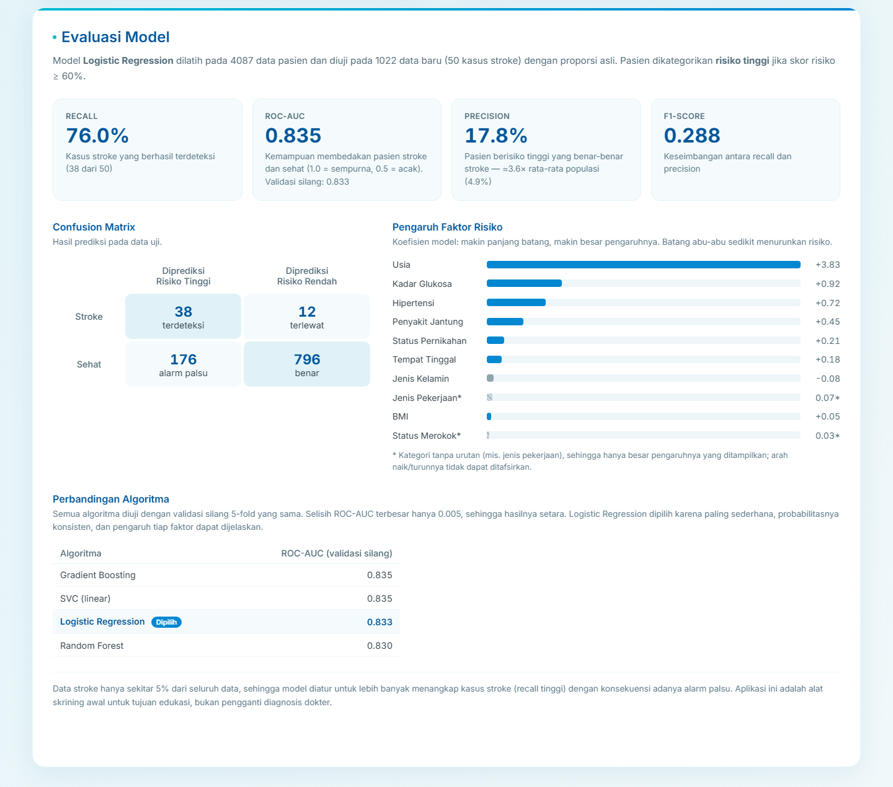
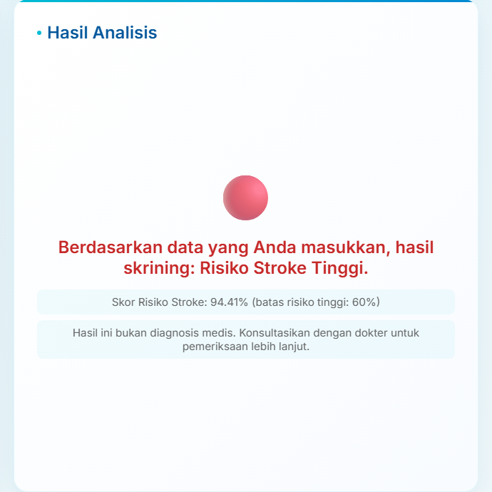
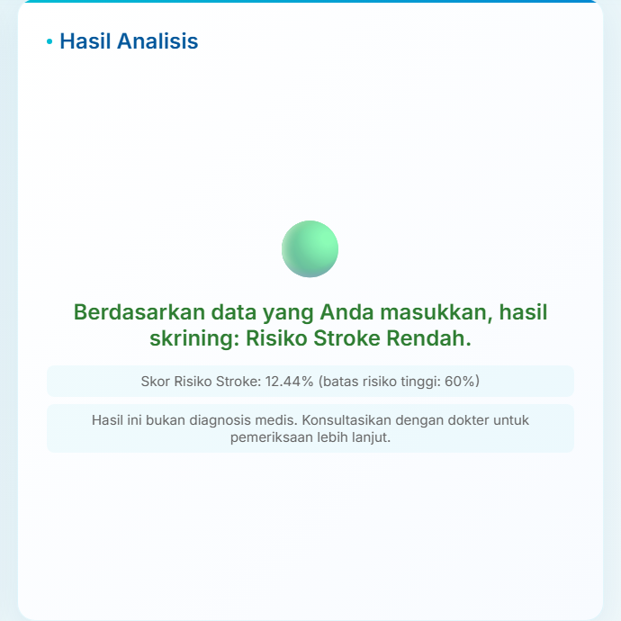

## Project Overview

Stroke is one of the leading causes of death and disability, yet many of its risk factors, such as hypertension, heart disease, glucose level, BMI, smoking habits, and age, can be recognized early. StrokeScreen offers a simple screening tool: users fill in ten basic health factors and a machine learning model estimates, within seconds, whether their stroke risk is high or low. The website consists of a landing page that explains stroke warning signs (the SeGeRa Ke RS campaign), how the screening works, and which factors matter most, plus a screening page with the form and a full model evaluation.

## Data & Model

The model was trained on the Kaggle Stroke Prediction Dataset, which contains 5,110 patient records with ten features: gender, age, hypertension, heart disease, marital status, work type, residence type, average glucose level, BMI, and smoking status. The dataset is highly imbalanced, with only about 4.9% of the records being stroke cases. Missing BMI values were filled with the median and clipped to a realistic range, age was grouped into five ranges (0–18, 18–36, 36–54, 54–72, and 72–90 years), categorical features were encoded with LabelEncoder, and all features were normalized with MinMaxScaler fitted only on the training data. The data was split 80/20 with stratification, giving 4,087 records for training and 1,022 untouched records (50 stroke cases) for testing. Instead of duplicating data, the imbalance was handled with `class_weight='balanced'`.

Four algorithms, Gradient Boosting, linear SVC, Logistic Regression, and Random Forest, were compared using the same 5-fold stratified cross-validation. Their ROC-AUC scores were almost identical (0.830–0.835), so **Logistic Regression** was chosen because it is the simplest, produces consistent probabilities, and its coefficients explain how much each factor contributes. Age turned out to be by far the most influential factor, followed by glucose level, hypertension, and heart disease. A patient is flagged as high risk when their risk score is 60% or higher.

On the test set, the model detects **76% of stroke cases (38 of 50)** with a **ROC-AUC of 0.835**. Its precision of 17.8% is about 3.6× higher than the stroke rate in the population, which is an acceptable trade-off for a screening tool where missing a stroke case is far more costly than a false alarm. The model, encoders, scaler, and evaluation metrics are saved as pickle and JSON files so that preprocessing during prediction is exactly the same as during training, and the website always shows the metrics of the model it is actually using.

## Web Application

The model is integrated into a web application built with Flask as the backend and HTML, CSS, and Jinja2 for the interface. Users fill in a form covering the ten risk factors, complete with value range validation. The data is sent to the server, encoded and scaled, and then scored by the model. The result shows a high or low risk category with the risk score in percent, color-coded in red or green. Form inputs are kept after each prediction, so users can change a single factor and immediately compare the results.

 

## Challenges & Learnings

The main challenge was dealing with imbalanced data, since high accuracy does not necessarily mean the model can detect stroke cases well. That is why the model was evaluated on recall and ROC-AUC on data it had never seen, and tuned to catch more stroke cases at the cost of some false alarms. Another challenge was keeping preprocessing consistent between training and the web application. Through this project, I learned the complete machine learning workflow, from data exploration and model selection to deploying a model into an application that everyday users can use.

> This application is an academic project for educational purposes and is not a substitute for professional medical diagnosis.
