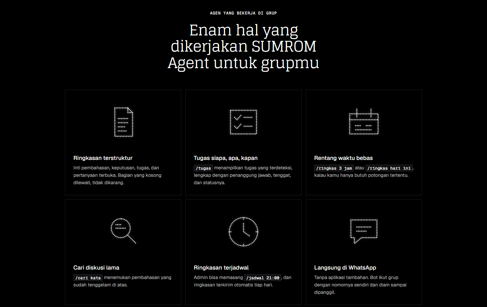
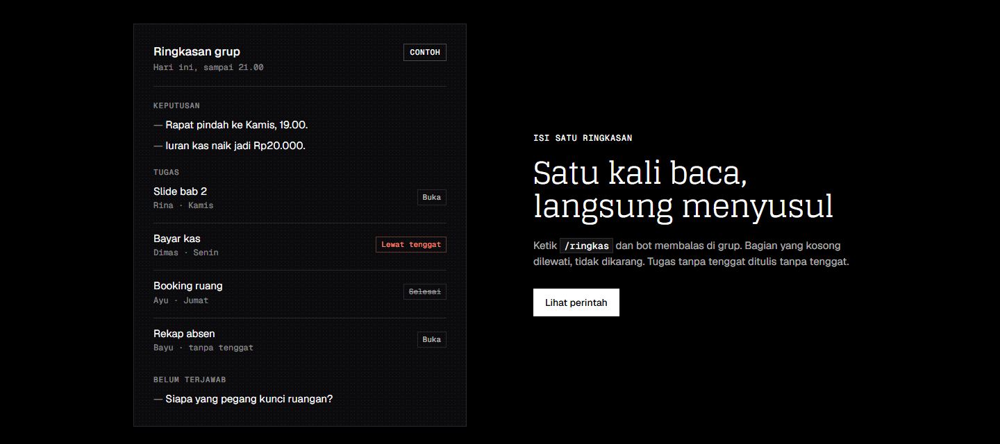
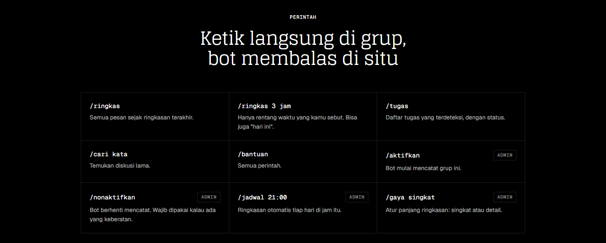
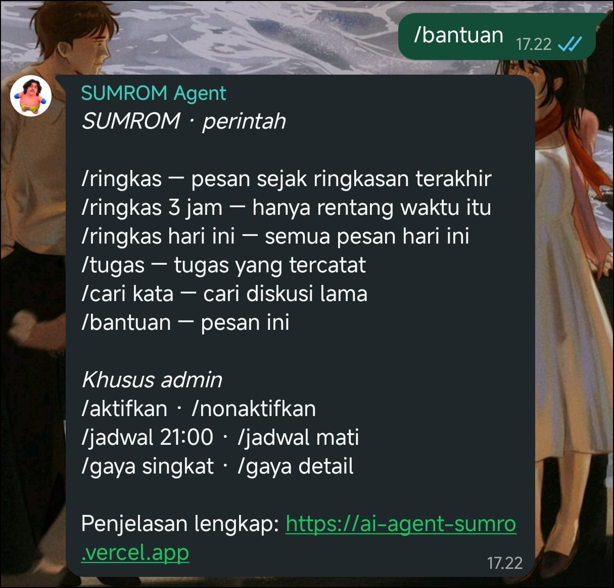

## Project Overview

Class, work, and community WhatsApp groups can produce hundreds of messages a day, and anyone who misses a few hours has to scroll through everything to catch up. SUMROM Agent solves this by joining the group from its own phone number, storing text messages, and posting a structured summary whenever someone types `/ringkas` or at a time scheduled by the admin. Each summary covers the core discussion, decisions, tasks in a who, what, and when format, and questions that are still unanswered. Sections with no content are skipped instead of being made up.

## Summaries & Commands

Every command is typed directly in the group and the bot replies there. Members can summarize everything since the last summary or only a chosen time range such as `/ringkas 3 jam` or `/ringkas hari ini`, list detected tasks with their owner, deadline, and status using `/tugas`, and search older discussions with `/cari`. Admins control the bot per group with `/aktifkan` and `/nonaktifkan`, schedule automatic daily summaries with `/jadwal 21:00`, and switch between short and detailed summaries with `/gaya`.

In WhatsApp, `/bantuan` replies with the full command list and a link to the landing page, so every member can see what the bot does without leaving the chat.

## Architecture

The bot is built as a Python plugin for Hermes Agent by Nous Research, using its built-in WhatsApp bridge based on Baileys. The plugin is split into commands, storage, summarization, and a scheduler, stores messages in SQLite, and is covered by unit tests. It runs with Docker Compose, with the WhatsApp session and database kept in a Docker volume and API keys kept out of the repository. The landing page is a static Astro site deployed on Vercel.

## Privacy by Design

Because the bot reads group conversations, transparency was treated as a core feature rather than an afterthought. The bot only works in groups an admin has explicitly enabled, members are notified, and raw messages are deleted automatically after a few days. The landing page, linked from the bot itself, explains in plain language what is recorded and what is not, that message content is sent to an AI model provider for summarization, and that a single member's objection is enough for the admin to turn the bot off.
