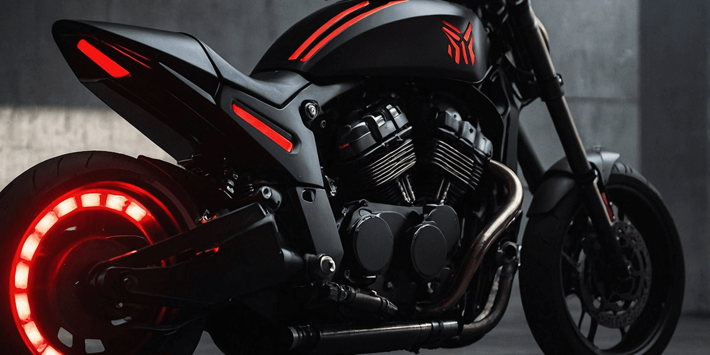
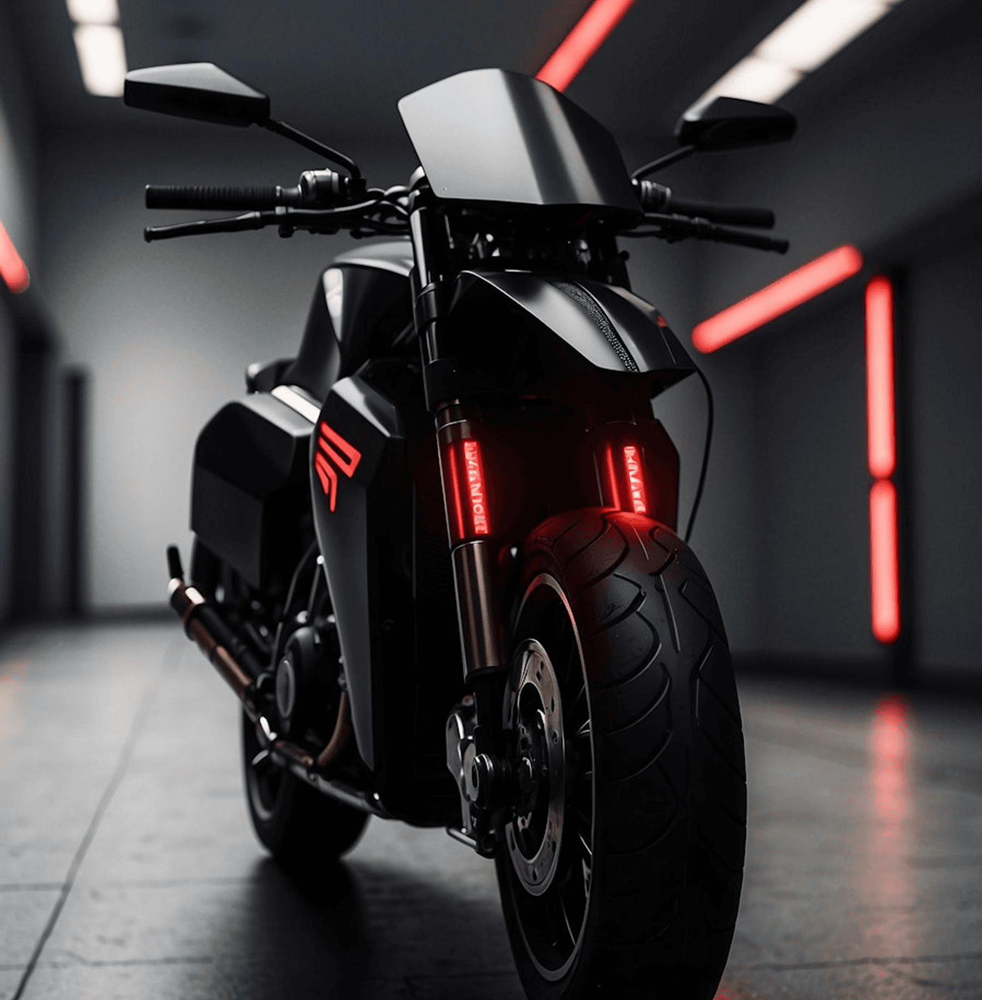
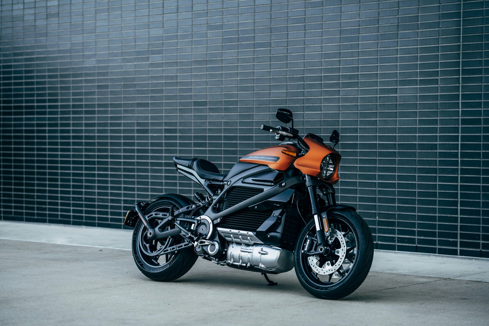

## Project Overviews

Voltgear is an intuitive EV tracking mobile application designed to give users real-time insights into vehicle performance, charging stations, and route optimization. The project focused on creating a seamless interface, combining data visualization with effortless navigation, ensuring that electric vehicle owners can manage their journeys efficiently while enjoying a smooth, responsive user experience.

## Work process

The Voltgear app was developed to provide a seamless and intuitive EV tracking experience, ensuring every feature contributes to clarity and usability. The process focused on real-time data visualization, route optimization, and smooth mobile interaction.

- Research on EV user behavior and charging patterns
- Planning app structure and user flows
- Wireframing dashboards and key screens
- Designing UI with intuitive controls and visual clarity
- Development with focus on performance and responsiveness
- Testing for usability, data accuracy, and reliability

 

## Approach

The development of Voltgear was guided by a clear and ambitious vision to provide electric vehicle users with a seamless, intuitive, and data-driven tracking experience. Every feature, from battery monitoring to route optimization, was carefully considered to balance functionality and usability. While convenience and clarity are universally valued, neglecting thoughtful interface design can lead to user frustration and reduced engagement. Similarly, complex analytics are not included for their own sake; they are incorporated strategically to provide meaningful insights and enhance decision-making. For example, integrating real-time route optimization alongside battery status empowers users to plan journeys efficiently, offering both confidence and convenience without overwhelming the interface.

> Innovation is not just about adding new features; it is about creating an experience that is clear, reliable, and empowering. Every interaction should provide confidence, allowing users to make decisions with ease while understanding the data presented. The ultimate goal is to merge functionality with simplicity to elevate the journey.

## Solution

The solution was achieved by integrating real-time vehicle tracking, route optimization, and intuitive data visualization into a cohesive interface. By balancing functional dashboards with interactive notifications and branded micro-interactions, the app enhances the user experience while reflecting Voltgear’s commitment to precision, innovation, and reliability. Every element was carefully designed to provide clarity, usability, and confidence during the user’s journey.
